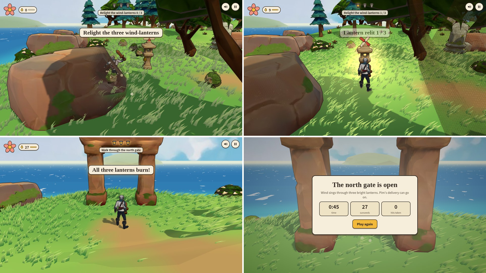
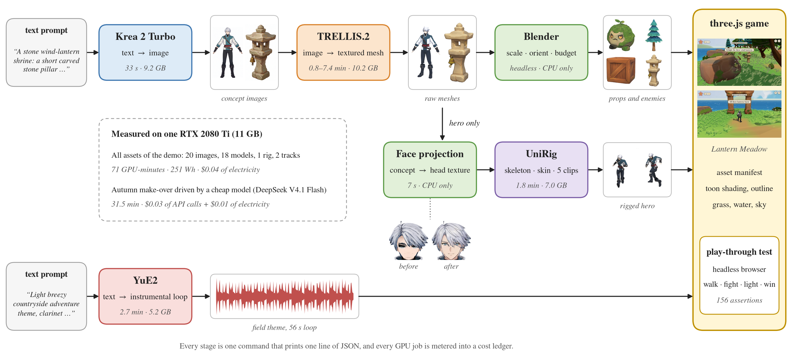
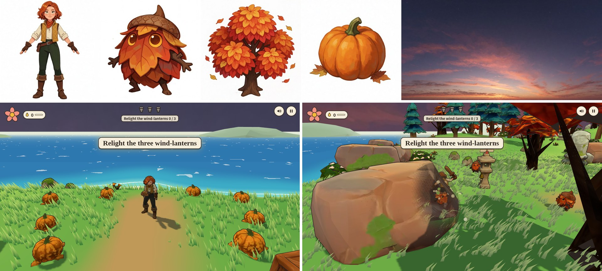

# Fiat Ludus · 言出法随

*Fiat ludus*: "let there be a game". Text in, playable 3D browser game out, on one
11 GB graphics card.



This repository is a pipeline of open models and tools that a coding agent can
drive from the command line, plus a small game, *Lantern Meadow*, whose hero,
enemies, props, sky and music all came out of it. Everything here ran on an RTX
2080 Ti (2018, 11 GB). A cheaper card of the same size class should work; a larger
one is only faster.



<sub>The thumbnails are real outputs of each stage. Vector versions: [SVG](docs/figures/pipeline.svg), [PDF](docs/figures/pipeline.pdf); source: [make_pipeline_figure.py](docs/figures/make_pipeline_figure.py).</sub>

## What is in the box

| Stage | Tool | What we added |
|---|---|---|
| Concept image | [Krea 2 Turbo](https://huggingface.co/krea/Krea-2-Turbo), GGUF-quantized | fits 11 GB: prompt padding removed, sub-models loaded one at a time, FP16 on cards without native BF16 |
| Image to 3D | [TRELLIS.2-4B](https://github.com/microsoft/TRELLIS.2) | fits 11 GB; batch mode; coarse-grid remesh that gives closed, game-ready meshes; steps down a resolution when memory runs out |
| Clean-up, previews | [Blender 5.2 LTS](https://www.blender.org/), headless | scale, orient, decimate, WebP textures, contact sheets for review |
| Face | Blender + numpy | projects the concept image back onto the model's head |
| Rig and animation | [UniRig](https://github.com/VAST-AI-Research/UniRig) + [Universal Animation Library](https://quaternius.com/packs/universalanimationlibrary.html) (CC0) | runs in about 7 GB; one 53-bone skeleton with standard names for every character; idle, walk, run, jump, attack |
| Music | [YuE2-3B](https://github.com/multimodal-art-projection/YuE2) | voice-free instrumental recipe, loop cut, loudness normalised |
| Game | [three.js](https://threejs.org/) + Vite | asset manifest with placeholders, toon shader, a scripted play-through as the test |
| Bookkeeping | `tools/gpu_run.sh` | one job per GPU at a time; time, peak memory and energy of every job in `cost/ledger.jsonl` |

## Quick start

```bash
# 1. install (no sudo needed; about 105 GB of disk; see docs/setup.md for sizes and traps)
setup/install_blender.sh
setup/env_krea.sh && setup/env_trellis2.sh && setup/env_unirig.sh && setup/env_yue2.sh
setup/download_models.sh
setup/check.sh

# 2. play the demo as shipped
cd game && npm install && npm run dev

# 3. make something new
./forge images assets/concepts/lantern-meadow.jsonl      # text -> concept images
./forge models assets/models/lantern-meadow.jsonl        # images -> meshes
./forge review assets/models/raw                         # one picture to judge them all
./forge install                                          # into the game, at the game's sizes
./forge check                                            # build it and play it headless
./forge cost                                             # what that cost
```

`./forge help` lists every command. [AGENTS.md](AGENTS.md) is the manual for coding
agents: file formats, how to judge a result, what to do when a stage fails.

## Can a cheap model drive it?

We gave DeepSeek V4.1 Flash a copy of this repository and one page of task
([tests/agent/task.md](tests/agent/task.md)): re-theme the demo for autumn with a new
rigged hero, a new enemy, a new tree, a new prop placed in the level, a new sky and
new music, and make the game's play-through test pass without touching the game's
source. One run, no human in the loop:

| | |
|---|---|
| Result | finished; the check passes with 23 of 23 assets loaded |
| Time | 31.5 min wall-clock, 21.9 min of it GPU work |
| Agent | 48 steps, 60 tool calls, $0.03 of API cost |
| GPU | 70.6 Wh, $0.01 of electricity |



Its report, prompts and cost ledger are in
[tests/agent/results/deepseek-v4.1-flash/](tests/agent/results/deepseek-v4.1-flash/).
`tests/agent/run.sh <model>` repeats the test with any model the `opencode` CLI can
reach. It is one run of one task; it says nothing about how often it would succeed.

## Measured on the RTX 2080 Ti

One job each, model load included unless noted, from `cost/ledger.jsonl`.

| Step | What was made | GPU time | Peak GPU memory | GPU energy |
|---|---|---|---|---|
| Concept images | 20 images, 1024×1024 (one job) | 11 min 3 s, 33 s per image | 9.2 GB | 42.9 Wh |
| Hero mesh | 1 character, resolution 1536, 20k triangles, 2048 texture | 2 min 10 s | 4.9 GB | 6.0 Wh |
| Prop meshes | 17 props, resolution 1024 (one job) | 51 min 38 s, 49 s to 7 min 25 s each | 10.2 GB | 187.3 Wh |
| Face projection | the hero's head texture | 7 s, CPU only | none | |
| Rig and animation | 53 bones, skin weights, 5 clips | 1 min 48 s in all, 70 s of it on the GPU | 7.0 GB | 1.2 Wh |
| Music | two looping instrumental tracks | 2 min 41 s and 2 min 40 s | 5.2 GB | 14.0 Wh |
| **All of the demo's assets** | | **about 71 min** | | **about 251 Wh** |

At 0.15 per kWh that is 0.04 of electricity. The same 17 props at resolution 512
take 11 min 43 s and 37 Wh, but stone and flower colours drift, so the demo uses
1024. One prop (the chest) did not fit in memory at 1024; the stage noticed, redid it
at 512 and said so in its report. Every job, including the failed experiments, is in
`cost/ledger.jsonl`; `./forge cost` adds them up.

## Requirements

- Linux and an NVIDIA GPU with 11 GB or more (tested: RTX 2080 Ti and RTX 3090).
- RAM: the pipeline keeps sub-models in RAM and moves them to the GPU one at a
  time, so plan for 32 GB or more. That figure is an estimate; the machine we used
  has much more and RAM use was not measured.
- About 105 GB of disk for environments and weights.
- No root access and no system CUDA toolkit: every environment brings its own.
- A Hugging Face account that has accepted the Krea 2 Turbo licence.

## Licences

The code in this repository is MIT. What it downloads is not all MIT:

| Component | Licence | Note |
|---|---|---|
| TRELLIS.2 code and weights, UniRig code and weights, BiRefNet | MIT | |
| Krea 2 Turbo weights | Krea 2 Community License (gated) | read its commercial-use terms |
| DINOv3 image encoder (used by TRELLIS.2) | DINOv3 License (gated at the source) | |
| nvdiffrast (used by TRELLIS.2's exporter) | NVIDIA Source Code License | read it before shipping a product built on the exporter |
| YuE2 weights | CC BY-NC 4.0, with a permission for individual creators to publish and sell what they generate | companies need a licence from the authors |
| Universal Animation Library (skeleton and clips) | CC0 | by Quaternius |
| Blender | GPL | used as a tool; the scripts in `pipeline/blender/` call its Python API, which MIT-licensed code may do, and the models it writes are yours |

The prompts in this repository describe a look by its attributes. They do not name
any game, studio, artist or musician, and neither should yours.

## Layout

```
forge                 the one entry point
AGENTS.md             manual for coding agents
pipeline/             one script per stage (+ pipeline/blender/ for the Blender side)
tools/                GPU wrapper, review sheet, cost report
setup/                install scripts and a doctor
assets/concepts/      prompts (JSON Lines) and the images they produced
assets/models/        3D settings (JSON Lines); raw meshes are written next to it
assets/animations/    CC0 skeleton and clips
game/                 Lantern Meadow (three.js), with its own README
tests/agent/          "can a cheap model drive this?": task and runner
cost/ledger.jsonl     every GPU job that was run for this repository
docs/                 setup guide, lab logs of each stage, figures
```
