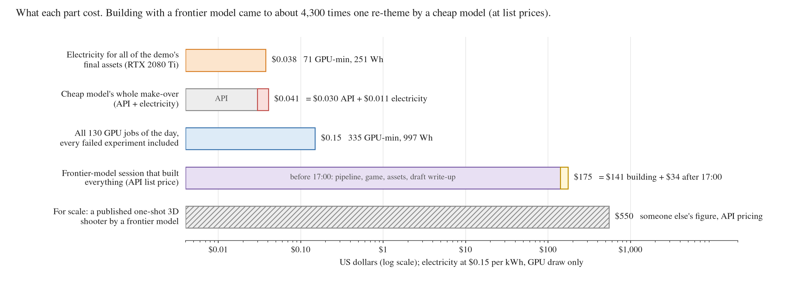
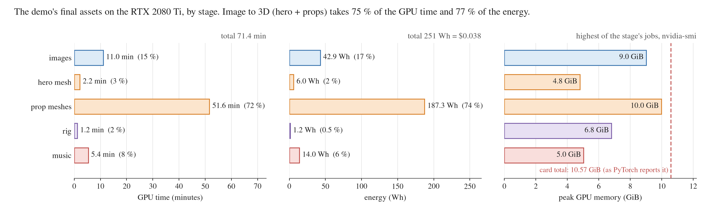
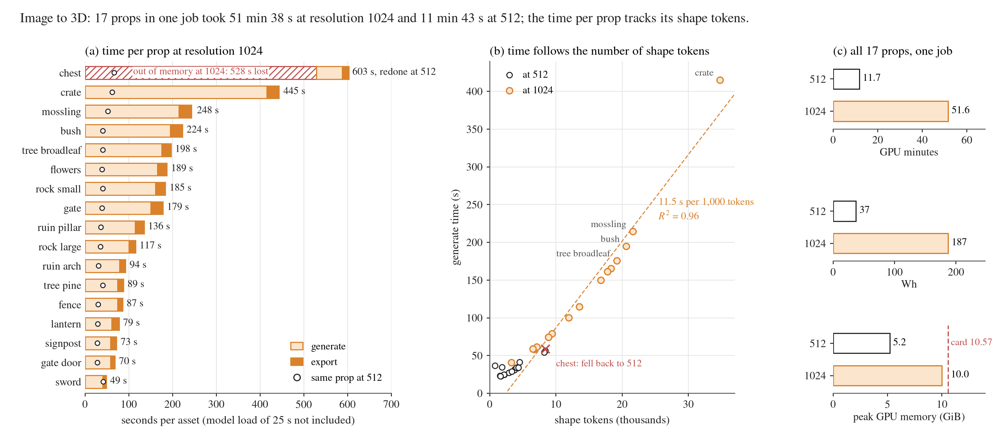
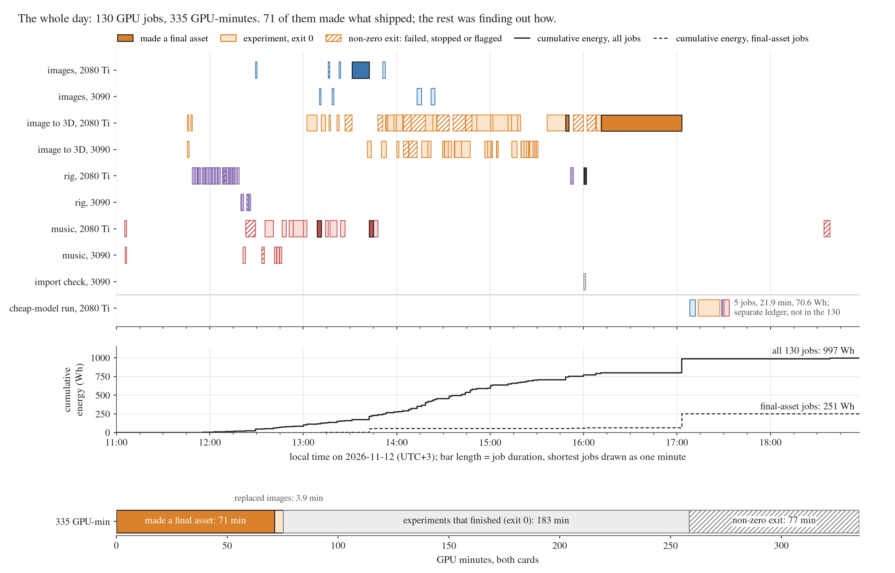
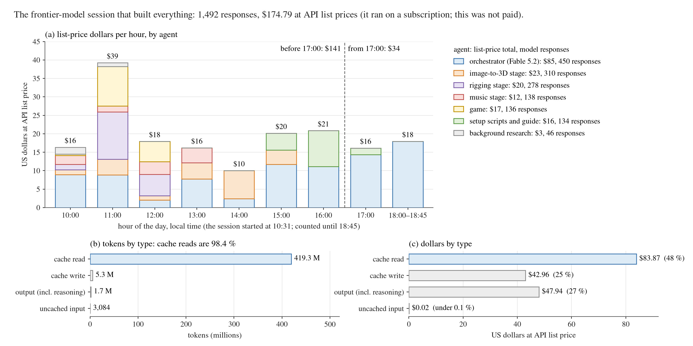
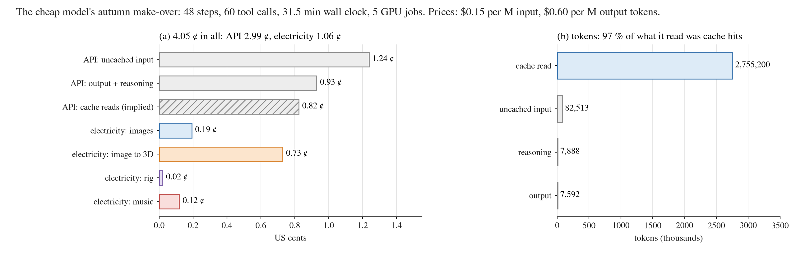
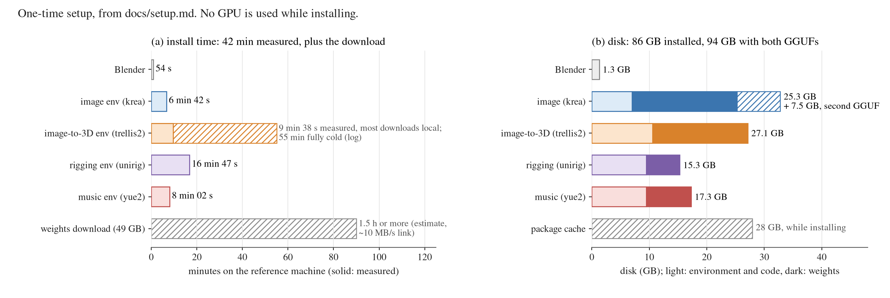
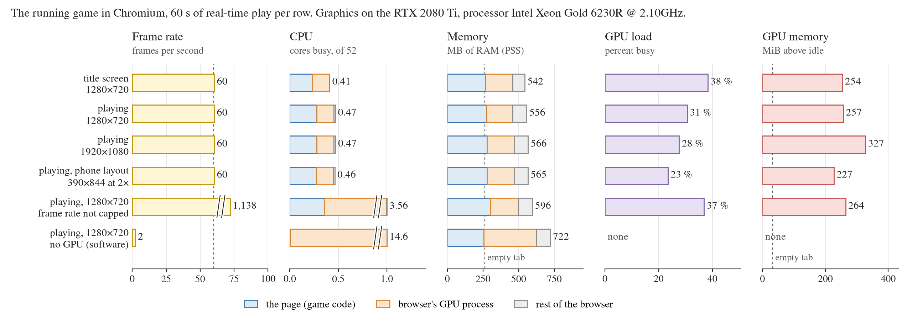
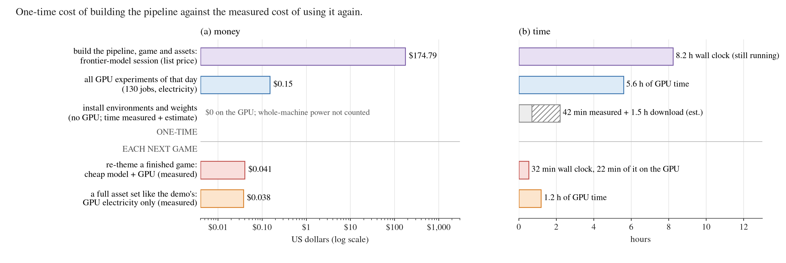

# What Fiat Ludus cost

This page breaks down the cost of building the pipeline and the demo game,
"Lantern Meadow", and the cost of using the pipeline again. Each figure comes
first, then a few sentences on what it shows. Every number here and in the
figures comes from `docs/figures/cost-numbers.json`, which
`docs/figures/make_cost_figures.py` writes from the repository's own records.
Numbers that came from somewhere else are marked as such.

The values range over more than four orders of magnitude, so the axis is
logarithmic. Electricity for every final asset of the demo was $0.038. The
cheap model's whole make-over of the game was $0.041: $0.030 of API cost and
$0.011 of electricity. All 130 GPU jobs of the building day, failed experiments
included, used $0.15 of electricity. The frontier-model session that built the
pipeline, the game and the assets would have cost $174.79 at API list prices.
That is about 4,300 times one re-theme. For scale, a widely read post by someone
else reports about $550 at API pricing for a 3D shooter that a frontier model
built from scratch in one shot. On a log axis a stacked bar understates its last
segment: the session's $34 after 17:00 looks thin next to the $141 before it.

## How it was measured

- **GPU jobs.** Every GPU job ran through `tools/gpu_run.sh`. The wrapper
  sampled `nvidia-smi` once a second and wrote one JSON line per job to
  `cost/ledger.jsonl`: start time, stage, label, card, seconds, average watts,
  peak memory, watt-hours and exit code. The energy is the GPU's own draw only,
  not the whole machine.
- **Electricity price.** $0.15 per kWh throughout.
- **Image-to-3D detail.** The stage writes one report per asset
  (`assets/models/raw/<id>.json`, and `raw-512/` for the same props at
  resolution 512) with the time spent generating and exporting, the number of
  shape tokens and the peak memory PyTorch reserved.
- **Tokens.** `cost/agent-tokens.json` adds up the usage field of every model
  response in the building session. It holds no message content. It is grouped
  by agent and by hour and priced at the API list prices bundled with the
  client. The count stops at 18:45 local time; the session was still running.
- **Cheap-model run.** `tests/agent/results/deepseek-v4.1-flash/` holds the
  client's token and cost summary, a per-turn timeline and the run's own GPU
  ledger.
- **Setup.** Times and sizes are copied from `docs/setup.md`, with its labels
  (measured, from a log, or an estimate).

## The demo's assets

Seven jobs on the RTX 2080 Ti made everything the demo ships: 20 concept images
(ledger line 63), the hero mesh at resolution 1536 (line 119), 17 prop meshes
at 1024 in one job (line 128), the rig in two jobs (lines 124 and 125), and two
music tracks (lines 52 and 65). Together they took 71.4 GPU-minutes and 251.4 Wh,
which is $0.038. Image to 3D is the expensive stage: 75 % of the GPU time and
77 % of the energy. The prop batch alone took 51.6 minutes. Rigging took 1.2
minutes and music 5.4 minutes. The prop meshes came closest to the card's
memory, at 10.0 GiB of the 10.57 GiB that PyTorch reports for the card.

One caveat: two images from that batch were replaced later. The sky came from a
second 2080 Ti job (line 68, 91.5 s, 4.6 Wh). The hero's concept was one of six
candidates drawn on the RTX 3090 (line 84, 142.0 s, 11.7 Wh). With those two
jobs the total is 75.3 minutes and 267.7 Wh, which is still $0.04.

## Where the GPU time goes

(a) At resolution 1024, the slowest prop (the crate, 445 s) took nine times as
long as the fastest (the sword, 49 s). The chest ran out of memory at 1024. The
stage then stepped down to 512 by itself, as designed, but the failed attempt
cost about 528 s, which makes the chest the most expensive item in the batch at
603 s. The same prop took 66 s in the 512 batch. The open circles show every
prop's time at 512; all lie between 28 s and 66 s.

(b) The generate time follows the number of shape tokens closely: about 11.5 s
per 1,000 tokens, with R² = 0.96 across the 16 props that ran at 1024. The
token count depends on how much surface the object has, not on its triangle
budget, so a bulky crate costs far more than a thin sword. At 512 every prop
stays under 8,400 tokens, which is why the 512 batch is so much flatter.

(c) For the whole batch of 17 props, 512 took 11 min 43 s and 37.3 Wh, and 1024
took 51 min 38 s and 187.3 Wh: 4.4 times the time and 5.0 times the energy. The
peak memory rose from 5.21 GiB to 9.97 GiB, close to the card's limit. The
demo uses 1024 because 512 shifted colours in our tests. If a prop can live
with that, 512 is the obvious saving.

## The whole day, experiments included

The building day had 130 GPU jobs between 11:05 and 18:34, 335.1 GPU-minutes
and 997.4 Wh in all ($0.15). Only 71.4 of those minutes (21 %) and 251.4 Wh
(25 %) made something that shipped; another 3.9 minutes made the two images
that replaced earlier ones. 183.2 minutes went to experiments that finished
normally: probes, precision tests on the two cards, memory caps for rigging,
seeds and resolutions for the hero. 18 jobs, 76.6 minutes and 264.3 Wh ended
with a non-zero exit code. That includes jobs that failed, two jobs stopped by
hand, and music jobs that exit with 1 to mean "generated, but look at it". One
of the stopped jobs (line 122) could not be measured, because the wrapper was
killed with it; its ledger line is an estimate and says so. The RTX 2080 Ti ran
84 jobs (265.5 minutes) and the RTX 3090 ran 46 jobs (69.6 minutes). The cheap
model's five jobs between 17:08 and 17:33 are drawn for context. They are in
that run's own ledger and are not part of the 130.

## The agents

A frontier model, Claude Fable 5.2, worked as orchestrator. It started six
Claude Opus 5.5 sub-agents: one each for the image-to-3D, rigging and music
stages, one for the game, one for the setup scripts and guide, and one for
background research. Together they built the pipeline, the game and the demo's
assets in one session that started at 10:31. The session made 1,492 model
responses. At API list prices they come to $174.79: $85.09 for the orchestrator
and $89.70 for the six sub-agents. The session ran on a subscription plan, so
this is what the same tokens would cost at list prices, not money that was
paid.

(a) The most expensive hour was 11:00 to 12:00, at $39.23, when the rigging,
game and image-to-3D sub-agents were all at work. About $141 (140.71) falls
before 17:00: building the pipeline, the game and the assets, plus the write-up
drafted along the way. About $34 (34.08) falls from 17:00 on, when the
orchestrator supervised the cheap-model test (17:06 to 17:38), published the
repository and wrote. After 17:00 almost all of the cost is the orchestrator.

(b) Of 426.4 million tokens, 419.3 million (98.4 %) were cache reads: the agents
re-read their long, cached context on every step. Cache writes were 5.3
million, output (reasoning included) 1.7 million, and uncached input only 3,084.

(c) In dollars the picture is different, because a cached token is cheap and an
output token is not. Cache reads cost $83.87 (48 %), output $47.94 (27 %) and
cache writes $42.96 (25 %); uncached input cost $0.02. The three main parts
are within a factor of two of each other.

For scale only, the published one-shot shooter mentioned above reports about
2.7 million output and 445 million input tokens (heavily cached) in about
8 hours. Those are someone else's numbers, for a different task.

## The cheap-model run

After the build, a cheap model, DeepSeek V4.1 Flash, got the finished repository
and one task: give the game an autumn make-over. It did not build or change the
pipeline. It ran the finished stages and changed a finished game. It worked
unattended for 31.5 minutes, in 48 steps and 60 tool calls, and started 5 GPU
jobs (21.9 GPU-minutes, 70.6 Wh). A timeline of the run is in
[agent-test-timeline.png](figures/agent-test-timeline.png).

(a) The whole run cost 4.05 cents: 2.99 cents of API cost as the client
reported it and 1.06 cents of electricity. At the model's listed prices ($0.15
per million input tokens, $0.60 per million output tokens), uncached input
comes to 1.24 cents and output plus reasoning to 0.93 cents. The remaining
0.82 cents must be the cache reads. That implies about $0.003 per million
cached tokens; this price is inferred, not listed. Of the electricity, image to
3D took 0.73 cents, again the largest stage.

(b) The model read 2,837,713 tokens, and 97 % of them (2,755,200) were cache
hits. It wrote only 7,592 output and 7,888 reasoning tokens.

## One-time setup

Installing Blender and the four Python environments took 42 minutes on the
reference machine (measured, 2,523 s), with no GPU in use. The image-to-3D
environment took 9 min 38 s with most downloads already local. A lab log puts
it at about 55 minutes fully cold, which would bring the total to about 87
minutes. Downloading the 49 GB of weights is estimated at 1.5 hours or more on
a link of about 10 MB/s. On disk, the environments, Blender and the three
upstream repositories take 37.8 GB, and the weights 48.5 GB. That is 86.3 GB
with one Krea GGUF file and 93.8 GB with both. The package cache adds up to
27.9 GB while installing (26 GiB), and `uv cache clean` frees it again.
`docs/setup.md` gives about 95 GB installed, which matches this sum.

## What the running game costs

`./forge measure` (`game/scripts/measure.mjs`) plays the built game in real time in
headless Chromium, 60 s per row, while an autopilot keeps the hero running in circles
and swinging the sword next to the first lantern. Once a second it records the CPU
time and memory of the browser's whole process tree and the card's load, memory and
power. Memory is PSS, so pages shared between processes are not counted twice. The
numbers are in `docs/figures/game-runtime.json`; graphics ran on the RTX 2080 Ti, the
processor is a Xeon Gold 6230R. The whole measurement was run twice, and the two runs
agree to within 0.01 core, 15 MB and one percentage point of GPU load.

- **At the browser's 60 frames per second, 1280×720:** 0.47 CPU cores (0.28 in the
  page, 0.17 in the browser's GPU process) and 556 MB of memory for the whole browser,
  of which the JavaScript heap is 18 MB. An empty tab of the same browser takes
  264 MB, so the game adds about 290 MB. The card is 31 % busy, holds 257 MiB for the
  browser (33 MiB for an empty tab) and draws 8 W more than idle: an hour of play is
  8 Wh on the card, a tenth of a cent.
- **Resolution matters little.** At 1920×1080 the CPU is the same, memory is 566 MB,
  the card is 28 % busy and holds 327 MiB. In the phone layout with the game's lower
  quality setting: 23 % and 227 MiB.
- **The title screen is the heaviest view** for the card (38 %), because its camera
  shows the whole island: 0.89 million triangles a frame against 0.69 million while
  playing.
- **Headroom.** With the frame-rate cap removed the same scene runs at about 1,140
  frames per second (median frame 0.7 ms, 99th percentile 3.4 ms) with 3.6 cores busy
  and the card at 37 %. The limit is the browser's CPU side, not the card. Nothing is
  presented on a screen in a headless browser, so read this as headroom, not as a
  benchmark.
- **It needs a GPU.** With software rendering the game manages 2 frames per second
  with 14.6 cores busy.
- **Loading.** 9.1 MB in 26 files; 2.7 s to the title screen from a local server.

Not measured: integrated graphics, real phones, other browsers, and the power of
anything but the graphics card.

## One-time against the next game

The left side is money and the right side is time. Building the pipeline was
the expensive part: $174.79 of frontier-model tokens at list price, and 8.2
hours of wall clock until the tokens were counted. The GPU experiments of that
day added $0.15 of electricity and 5.6 GPU-hours. Installing everything costs
no GPU energy, but it takes 42 minutes plus the download. After that, both
measured ways of using the pipeline cost about four cents. The cheap model's
re-theme cost $0.041 in 32 minutes. A complete asset set like the demo's needs
$0.038 of electricity and 1.2 hours of GPU time. That second number does not
include an agent to drive it. These are two measured cases, not a prediction
for every game. A new game with new mechanics would need more agent work than a
re-theme.

## What is not counted

- **Human time.** The owner's time spent setting goals, reviewing and judging
  play feel.
- **Hardware.** The price of the two GPUs and the machine, and their wear.
- **Bandwidth.** 49 to 57 GB of weights plus the Python packages of four
  environments, downloaded once (sizes in `docs/setup.md`).
- **CPU and whole-machine power.** Blender clean-up, face projection, install
  and the play-through checks run on the CPU. None of that is in the ledger, and
  neither is the power the rest of the machine drew during GPU jobs.
- **Idle draw.** The cards' draw between jobs is not counted.
- **The session after 18:45.** Tokens were counted while the session was still
  running.

## Summary

Building Fiat Ludus and its demo took one session of a frontier model with six
sub-agents. At API list prices its tokens would cost $174.79; it ran on a
subscription. The same day's 130 GPU jobs drew 997.4 Wh ($0.15), and only a
quarter of that energy went into the assets that shipped. Setup is a one-time
42 minutes of installing, plus the download and about 94 GB of disk. Once the
pipeline exists, using it is cheap: the demo's full asset set costs $0.038 of
electricity on an 11 GB card, and a cheap model re-themed the finished game for
$0.041 all in. Image to 3D is three quarters of the GPU bill, and dropping props
from resolution 1024 to 512 would cut that stage's time by a factor of 4.4.
