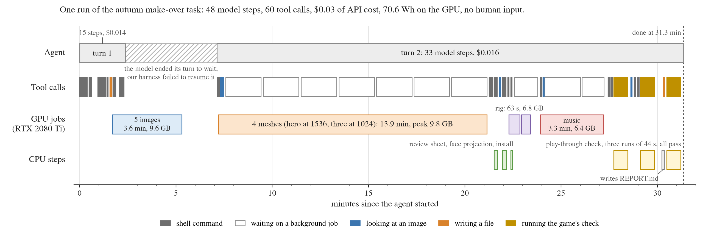
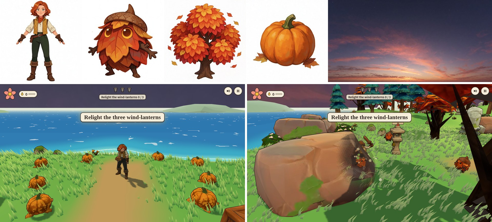
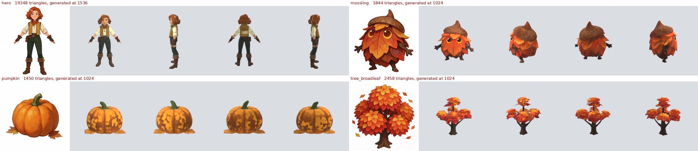
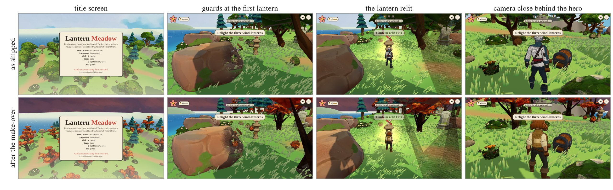
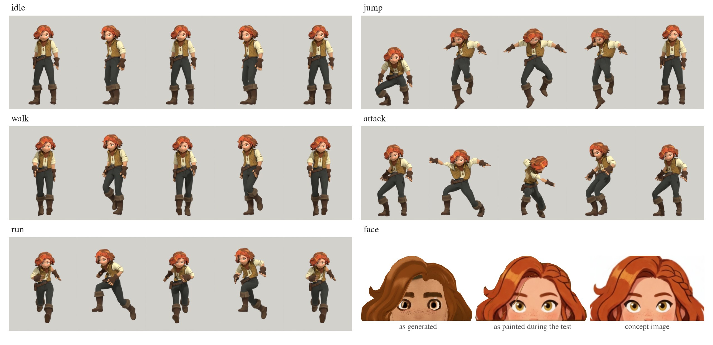

# The cheap-model test: DeepSeek V4.1 Flash

One run of one task by one model, on 2026-11-12. Everything here is read from the
run's own files in this folder; where it says how something looks, that is our
judgement from the pictures.

## What was tested, and what was not

The cheap model did **not** build the game. It was given this repository as it
stands and asked to change the game with it ([task](../../task.md)).

| | Built beforehand (Claude Fable 5.2 with Opus sub-agents) | Done by DeepSeek V4.1 Flash in this run |
|---|---|---|
| Game code | all of it, including the play-through check | none; the task forbids touching `game/src/` |
| Pipeline | every stage script, `./forge`, `AGENTS.md` | none; it only called them |
| Original assets | the demo's 21 assets, left installed | kept 16, replaced 5 |
| New assets | none | hero (with face and rig), enemy, tree, pumpkin, sky, field music |
| Game data | manifest and level formats, the original level | one manifest entry, eight placements |
| Decisions during the run | none: no person, no other model | what to make, in which order, when to look, when to stop |

It read the original demo's prompt and settings files before writing its own, and
the hero's 3D settings are the example line from `AGENTS.md`. The subjects, seeds,
the pumpkin's size and collider, the placements and the music prompt are its own.
What building the pipeline and the game cost is in [docs/cost-analysis.md](../../../../docs/cost-analysis.md).

## Result

| | |
|---|---|
| Outcome | finished; `./forge check` exited 0 three times in a row; `REPORT.md` written |
| Time | 31.3 min from the first to the last event |
| Agent | 2 turns, 48 model steps, 60 tool calls (47 shell, 9 image reads, 3 file writes, 1 job watch) |
| Tokens | 82,513 input, 2,755,200 read from cache, 7,592 output, 7,888 reasoning |
| API cost | $0.0299, as reported by the client per step |
| GPU | 5 jobs, 21.9 min, 70.6 Wh, $0.0106 at $0.15 per kWh, peak 9.8 GB (RTX 2080 Ti) |
| Failed jobs, regenerated assets | 0, 0 |
| Game afterwards | 22 generated assets, none a placeholder |
| Quality problems it did not catch | a thin tree and a blotchy pumpkin, a half-painted face, music that measures like singing |

Of the 31.3 minutes, a generation job was running for 22.3, the model was thinking
for 6.4 (time inside its turns that was not spent inside a tool), three runs of the
check took 2.2, and 1.8 were lost to our harness. The parts overlap.

## What it made

| Asset | Seeds (image, 3D) | Generated at | Mesh time | Triangles, raw then in the game | Bad edges | How it turned out |
|---|---|---|---|---|---|---|
| Hero | 21, 78 | 1536 | 2 min 9 s | 19,348, then 19,274 with 53 bones | 0.6 % | close to the concept; face below |
| Enemy (`mossling`) | 31, 79 | 1024 | 3 min 28 s | 3,844, then 2,500 | 0.6 % | matches; the amber eyes survived |
| Tree (`tree_broadleaf`) | 41, 80 | 1024 | 4 min 25 s | 2,458, then 999 | 2.9 % | five leaf clumps on bare branches where the concept has a full crown |
| Pumpkin (new) | 51, 81 | 1024 | 3 min 28 s | 1,450, then 800 | 0.0 % | right shape; blotchy texture where the concept is evenly orange |
| Sky | 61 | 2048×1024 | 61 s (image) | | | as described |
| Field music | 14 | | 3 min 17 s | 60.0 s loop from an 84 s render | | measures like a sung track |

## What it missed, and what was wrong on our side

- **It took every first result.** The thin tree is in its report as "airier than the
  concept"; the pumpkin's texture is not.
- **The face is half painted.** Our face projection assumed a head is the top 14.5 % of
  a figure; this hero's is 19.6 %. The fit score looked fine (0.735) and the agent did
  not open the debug picture. Fixed: the head is now found from the outline
  ([result with the fix](../../../../docs/figures/face-projection-second.jpg)).
- **The music measures like singing.** Vocal stem against the mix: −6.1 dB with 33 % of
  the one-second windows flagged, where the demo's own loops measure −55 dB and
  −60 dB with none, and tracks we know were sung −3 to −6 dB. The music stage had
  printed these numbers and exited 0. Fixed: it now exits 1 with `"voice": "likely"`;
  re-running this exact request reproduced the audio and returned 1. Nobody has
  listened to the track.
- **Our harness did not resume the agent** after it ended its first turn to wait for a
  job (`grep | head` under `pipefail`). Fixed; the task now says that waiting means
  polling.

None of these makes the check fail: a check that plays the game says whether it runs,
not whether it looks and sounds right. The check itself ran 131 assertions per run
instead of the repository's 156, because two optional passes need a folder that is
not tracked by git. We compared every number in its report with the logs; they match.

## What this run does not show

How often it works (it is one run); that a cheap model can build the pipeline or the
game; that a model without image input can do it (this one looked nine times); or a
good game.

## Files

| File | What |
|---|---|
| `REPORT.md` | the model's own report, unedited |
| `concepts.jsonl`, `models.jsonl` | the two files it wrote for the image and mesh stages |
| `ledger.jsonl` | its five GPU jobs |
| `agent-summary.json` | steps, tool calls, tokens, cost |
| `timeline.json` | digest of the event log: each turn, each tool call with start and end, the GPU jobs |
| `screens.jpg` | its concept images and two screenshots |

`tests/agent/run.sh <model>` repeats the test with any model the `opencode` client can
reach.
